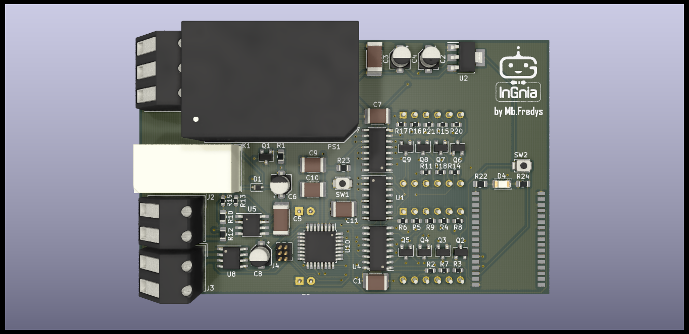

# Temperature Controller — Hardware Design

Temperature-control PCB design integrating sensing, local displays, setpoint buttons and a relay output.

> **Status: hardware design requiring review and prototype validation.** KiCad sources, a PDF schematic, PCB renders and fabrication exports are published. Firmware is not provided. Temperature accuracy, control stability, Bluetooth operation and electrical safety are not demonstrated by the repository.

## Intended architecture

The published component netlist includes:

- **ATmega328P-AU** microcontroller.
- **MAX31855TASA** thermocouple interface.
- **AD623** instrumentation amplifier in the PT100-related circuit.
- **BTM112** Bluetooth module.
- Two **CA56-12EWA** display assemblies with shift-register/multiplexing circuitry.
- **FINDER 36.11** relay and transistor driver.
- **RAC01-05SGB** AC/DC module and **LM1117-3.3** regulator.

PT100 and thermocouple inputs are design intentions. Supported sensor ranges, excitation, calibration, error budget and fault detection must be established from a complete circuit review and measurements.

## Engineering scope

The project brings together analog sensing, digital display interfacing, a user interface, communication hardware and load control. The available files document the proposed circuit and PCB, rather than a validated controller.

## Required verification

- Confirm module variants, pin assignments, voltage levels and the complete power budget.
- Review the PT100 excitation and amplifier gain, offset, input range and error budget.
- Check thermocouple type, cold-junction behavior and fault response.
- Verify display drive currents and multiplexing timing.
- Define sensor-fault handling, relay safe state, hysteresis/control law and watchdog behavior.
- Review mains separation, creepage/clearance, fusing, enclosure and relay/load ratings before any powered work.
- Develop firmware and record prototype tests.

The AC input range of a selected module does not establish the safety or certification of the complete PCB. Existing Gerbers must not be treated as a fabrication release.

## Files

- [KiCAD files](KiCAD%20files/): editable sources and exported component/net information.
- [PDF schematic](PDF%20Schematic/Controlador-temperatura.pdf).
- [Manufacturing](Manufacturing/): historical fabrication outputs.
- [Release](Release/): PCB renders.
- [Firmware](Firmware/): availability note.

The legacy project uses the `.sch` / `.pro` file format. Preserve an original copy and verify any migration in a supported KiCad version.

## Contributing

Proposed improvements should state the circuit change, its rationale and the checks performed. Keep schematic, PCB, BOM and fabrication outputs synchronized.

## License

CERN-OHL-W-2.0. See [LICENSE](LICENSE) and [COPYING](COPYING).
